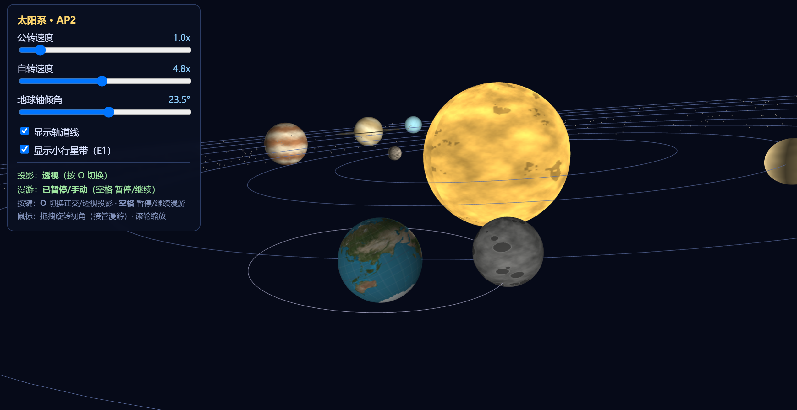
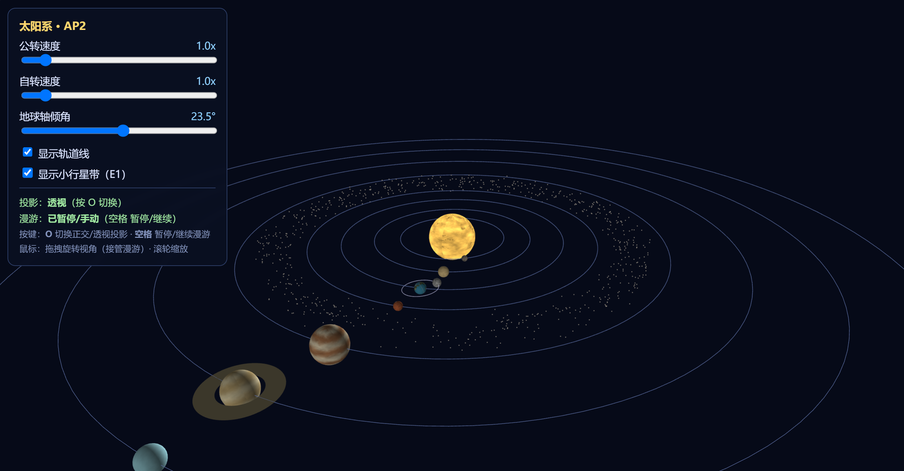
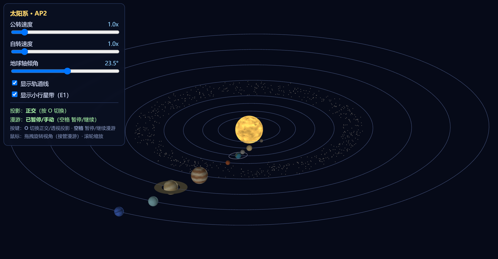
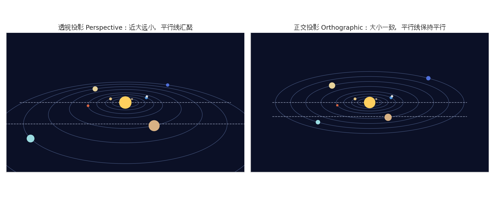

# AP2 · 三维层级场景:太阳系

软件242 宗美旭 2406100433

## 1. 运行方式
**公网URL**：<https://1124-z.github.io/AP1/>

### 目录结构

```
.
├── index.html          # 页面骨架 + 参数面板
├── main.js             # 场景 / 着色器 / 交互 / 主循环
├── MV.js               # 列主序 4x4
├── textures/           # 11 张位图纹理
│   ├── sun.png
│   ├── mercury.png
│   ├── venus.png
│   ├── earth.png
│   ├── mars.png
│   ├── jupiter.png
│   ├── saturn.png
│   ├── uranus.png
│   ├── neptune.png
│   └── moon.png
└── README.md
```

---

## 2. 实现要点

### 2.1 层级结构--变换嵌套树

太阳系采用"父节点矩阵逐层右乘"的方式建模。列主序下 `multiply(A, B) = A·B`,对顶点先施加 `B` 再施加 `A`,因此越靠右越先作用于局部坐标。变换嵌套树如下:

```
世界
└── 太阳 SUN
    └── M_sun = R_y(sunSpin) · S(r_sun)                    ← 自转 + 缩放
└── 行星轨道节点(每颗行星)
    ├── node = R_y(orbit) · T(dist, 0, 0)                  ← 公转 + 轨道半径
    ├── 行星本体
    │   └── M_planet = node · R_x(tilt) · R_y(spin) · S(r)  ← 倾角 → 自转 → 缩放
    └── 地球专属子节点
        └── 月球轨道节点
            ├── moonNode = node · M_tiltX(5.14°) · R_y(moonOrbit) · T(d_moon,0,0)
            └── M_moon = moonNode · R_y(moonSpin) · S(r_moon)
```

**地球轴倾角的"先转后挂"**

地球模型矩阵构造顺序为:

```js
let m = multiply(node, rotationX(tiltDeg));   // ① 先在自身坐标系施加倾角
m = multiply(m, rotationY(p.spin));           // ② 再自转
m = multiply(m, scaling(r, r, r));            // ③ 最后缩放
```

- `rotationX(tiltDeg)` 位于 `node` 内侧,意味着倾角作用于"地球自身坐标系",地轴方向在空间中保持定向,不会随公转扫动;
- 若反过来写成 `multiply(rotationX(tiltDeg), node)`,倾角会作用于"公转后的世界坐标",地轴会绕世界 Y 轴旋转,公转一圈后地轴指向随之改变,物理上错误。

### 2.2 手动矩阵:月球轨道面倾角

月球轨道面相对黄道有约 **5.14°** 的倾角。本项目调用 `MV.js` 的
**mat4 基本变换** `rotationX` / `rotationZ`,再用 `multiply` 手工组合:

    M_moonOrbit = R_x(5.14°) · R_z(φ)

列主序约定:`multiply(A, B) = A·B`,对顶点先施加 B 再施加 A。
该矩阵挂在地球轨道节点内侧(`node · M_moonOrbit · R_y(月相角) · T(d) · …`),
使倾角作用于“月球自身坐标系”,月球轨道面方向在空间中保持定向,
不会随地球公转扫动——与地球轴倾角“先转后挂”是同一顺序原则。



> 可见地球自转轴相对黄道面倾斜约 23.5°,月球轨道面相对黄道面倾斜 5.14°(由 `manualTiltMatrixX` 施加),月球轨道线随地球公转整体平移。

**逐元素推导**:绕 X 轴旋转 θ 的行主序数学写法为

    [ 1    0     0    0 ]
    [ 0   cosθ  -sinθ 0 ]
    [ 0   sinθ   cosθ 0 ]
    [ 0    0     0    1 ]

WebGL 的 `uniformMatrix4fv` 按列主序读取数组,`arr[c*4+row]` 对应
第 `row` 行第 `c` 列。逐列写出即:

    [ 1, 0, 0, 0,      // 列0:(1,0,0,0)
      0, c, s, 0,      // 列1:(0,c,s,0)   对应 [1][1]=c, [2][1]=s
      0,-s, c, 0,      // 列2:(0,-s,c,0)  对应 [1][2]=-s, [2][2]=c
      0, 0, 0, 1 ]     // 列3:(0,0,0,1)

### 2.3 表面纹理与上下颠倒问题

太阳、地球、月球(以及全部 8 颗行星)各贴一张位图纹理,流程为:

1. `gl.texImage2D(gl.TEXTURE_2D, 0, gl.RGBA, gl.RGBA, gl.UNSIGNED_BYTE, img)` 上传;
2. 顶点着色器将 `aTexCoord` 传给片元着色器 `vTexCoord`;
3. 片元着色器 `texture2D(uSampler, vTexCoord).rgb` 采样。

**上下颠倒问题**:浏览器解码 PNG 后,图像数据首行是"图片顶部";而纹理坐标 `v=0` 对应上传数据的首行。球体几何体(`createSphere`)中 `uv.push(lon/lonBands, 1.0 - lat/latBands)`,即 `v=1` 在北极、`v=0` 在南极。若不处理,贴图会南北倒置。解决方式:

```js
gl.pixelStorei(gl.UNPACK_FLIP_Y_WEBGL, true);
```

该调用让 `texImage2D` 在上传时翻转 Y 轴,使"图顶对球顶"。纹理参数设置 `WRAP_S = REPEAT`(经度方向环绕)、`WRAP_T = CLAMP_TO_EDGE`(纬度方向不重复),`MIN/MAG = LINEAR`,保证球面采样平滑。

### 2.4 双投影对比

按 `o` 键切换 `perspectiveMode`,每帧调用 `currentProjection()`:

- **透视**:`perspective(45°, aspect, 1, 2500)`,近大远小,平行线向灭点收敛;

- **正交**:`ortho(-halfW, halfW, -halfH, halfH, 1, 2500)`,`halfH = 170`,平行线保持平行,无近大远小。

> 差异说明:透视下靠近相机的行星明显大于远处行星,轨道圆环呈椭圆并向远处收敛;正交下所有行星缩放一致,轨道圆环保持正圆(或统一椭圆),不受深度影响。



### 2.5 相机漫游与接管

- **漫游路径**:`roamPos(t)` 为光滑参数曲线,半径 `R = 360 + 70·sin(0.13t)`、高度 `h = 130 + 90·sin(0.09t + 1.7)`、方位角 `a = 0.22t`,绕场景一周且带正弦起伏;
- **暂停/继续**:`空格` 调用 `toggleRoam()`;
- **鼠标接管**:`mousedown` 时置 `camera.roaming = false`;轨迹球旋转用四元数 `quatAxisAngle` / `quatRotate` 实现;
- **平滑回归**:重新开启漫游时,`updateCamera` 用 1.6s 的 smoothstep 从当前 `eye` 插值回 `roamPos(now)`,避免视角跳变;
- **缩放**:`wheel` 事件沿视线方向按指数因子调整 `eye` 到 `at` 的距离,并夹在 `[30, 1200]` 防穿模;
- **平移**:右键或 `Shift + 左键` 拖拽,按相机右/上方向平移 `eye` 与 `at`,速度与相机距离成正比。

- **漫游录屏**:[点击观看漫游录屏](screenshots/roaming.mp4)

- **E1 细节**:`PLANETS` 数组集中配置 8 颗行星的半径、轨道半径、公转周期、自转周期、轴倾角、初始相位与回退色;土星环由 `createRing(1.24r, 2.27r)` 生成,继承土星轨道节点并 `rotationX(90°)` 放平;小行星带由 `createBeltPoints` 以固定种子伪随机生成 700 个点,内外半径 122–148,高度 ±6。
- **E3 细节**:鼠标位置经 `arcballVec` 映射到单位球面,取相邻两点构造旋转轴与夹角,用四元数旋转 `camera.eye` 与 `camera.up`,避免万向锁。

### 2.6 参数面板

| 控件 | 作用 | 绑定变量 |
|---|---|---|
| 公转速度滑条 | 0–10x,缩放所有公转角速度 | `orbitSpeedF` |
| 自转速度滑条 | 0–10x,缩放所有自转角速度 | `spinSpeedF` |
| 地球轴倾角滑条 | 0–45°,仅作用于地球 | `tiltDeg` |
| 显示轨道线 | 开关所有轨道圆环 | `showOrbits` |
| 显示小行星带| 开关 700 点小行星带 | `showBelt` |

---

## 3. 交互说明

| 操作 | 效果 |
|---|---|
| **鼠标左键拖拽** | 虚拟轨迹球旋转视角 |
| **Shift+左键拖拽** | 平移视角|
| **鼠标滚轮** | 沿视线方向缩放 |
| **`o` 键** | 切换正交 / 透视投影 |
| **`空格`** | 暂停 / 继续相机漫游 |
| **面板滑条** | 实时调节公转速度、自转速度、地球轴倾角 |
| **面板复选框** | 显示 / 隐藏轨道线、小行星带 |

---